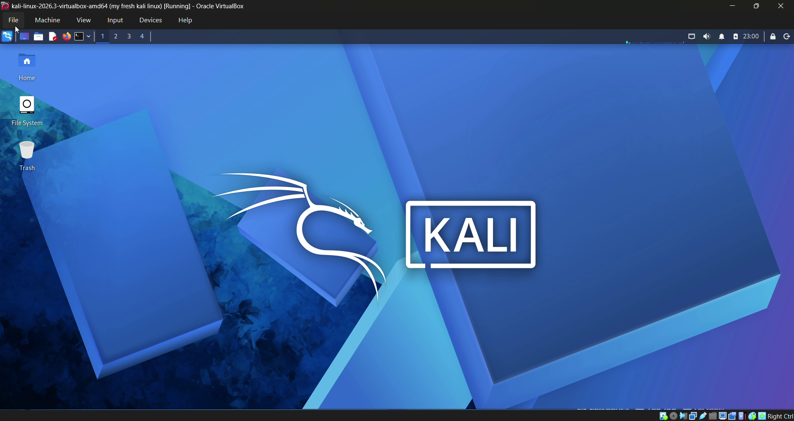
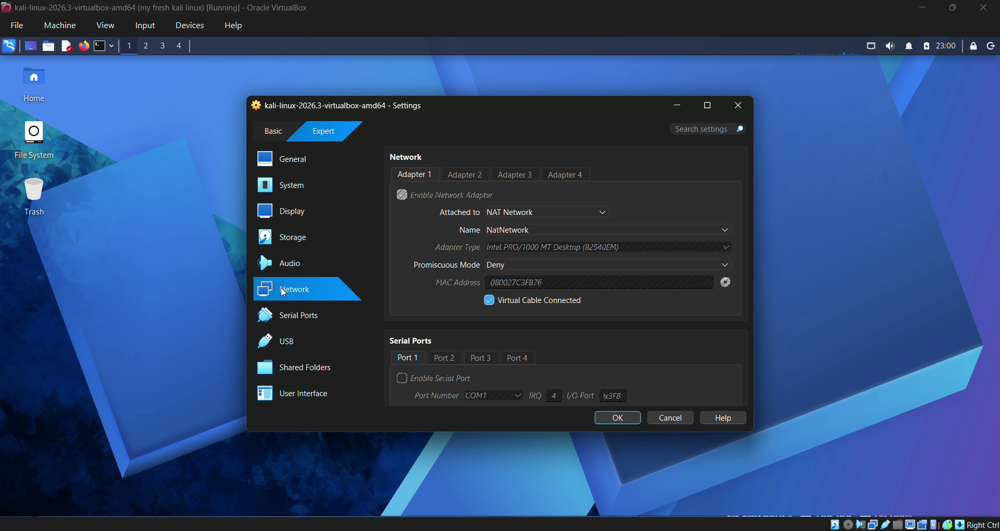
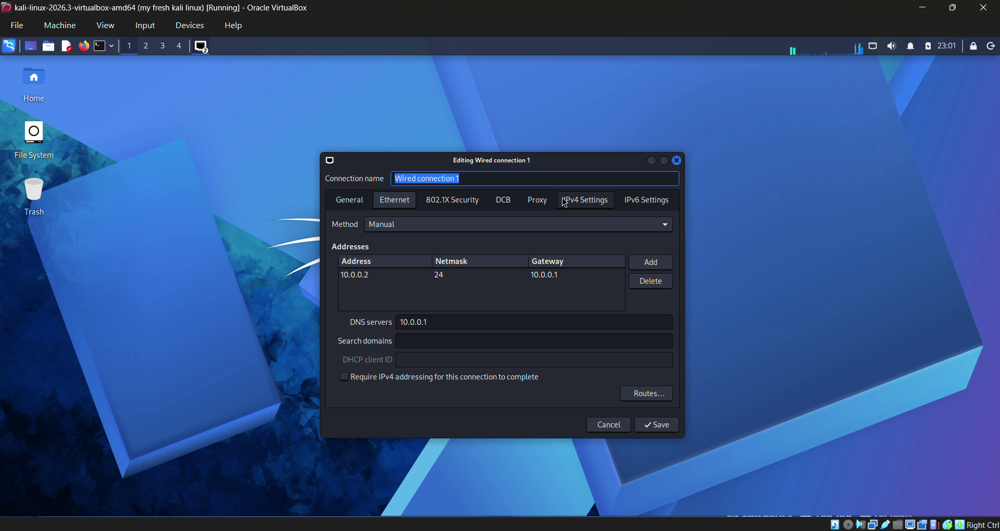
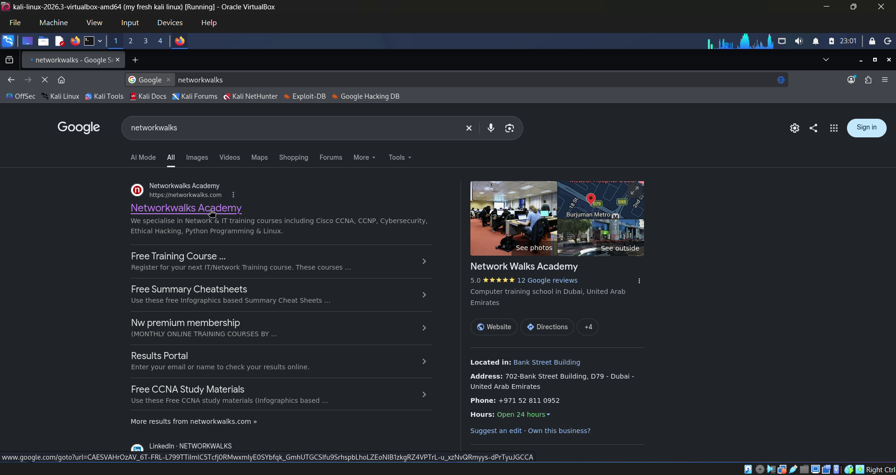
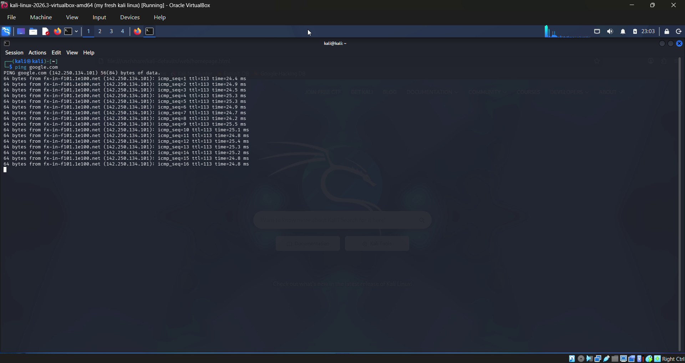
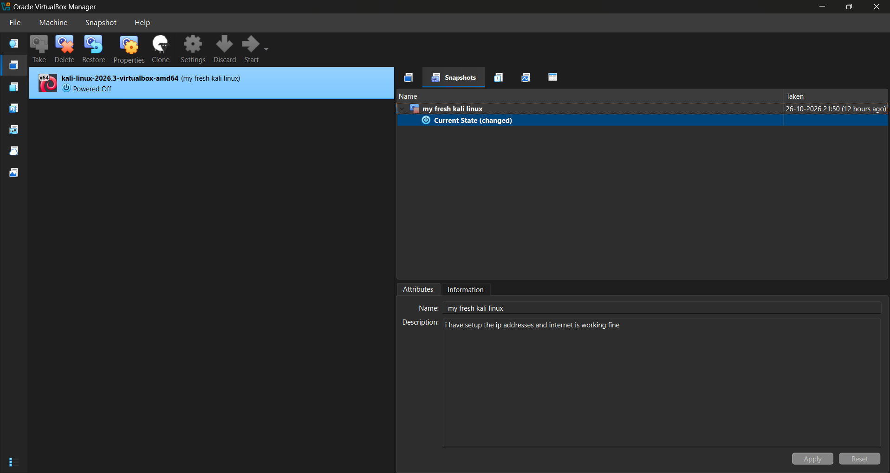

# Cybersecurity Lab Setup — Kali Linux & VirtualBox

## Project Overview

I set up a virtual cybersecurity lab using Kali Linux and Oracle VirtualBox as part of my cybersecurity learning journey.

The main objective of this project was to configure a Kali Linux virtual machine, establish internet connectivity, troubleshoot networking issues, and create a snapshot to preserve the working lab environment.

I also used this environment to practice Linux commands and complete Linux lab exercises and Capture The Flag (CTF) challenges.

## Lab Environment

- **Host Operating System:** Windows
- **Virtualization Software:** Oracle VirtualBox 7.x
- **Guest Operating System:** Kali Linux 2026.x
- **Network Configuration:** VirtualBox NAT Network (`10.0.0.0/24`)

## Tools Used

- **Kali Linux** — Linux environment for cybersecurity learning and practical exercises.
- **Oracle VirtualBox** — Virtualization software used to run Kali Linux.
- **Linux Terminal** — Used to execute commands and test network connectivity.
- **VirtualBox NAT Network** — Configured to provide network connectivity to the virtual machine.

## Lab Setup and Configuration

The following steps were completed during the lab setup:

1. Set up and launched Kali Linux in Oracle VirtualBox.
2. Configured a VirtualBox NAT Network using the subnet `10.0.0.0/24`.
3. Reviewed Kali Linux network settings and troubleshot internet connectivity issues.
4. Verified connectivity by opening a webpage in the Kali Linux browser.
5. Used the `ping` command to test connectivity to `google.com`.
6. Created a VirtualBox snapshot to preserve the working virtual machine state.
7. Practiced Linux commands and completed Linux lab exercises and CTF challenges.

## Screenshots

### 1. Kali Linux Desktop

### 2. VirtualBox NAT Network Configuration

### 3. Kali Linux IPv4 Settings

### 4. Browser Connectivity Test

### 5. Successful Ping Test

### 6. VirtualBox Snapshot

## Challenges Faced

### Network Connectivity

After changing the VirtualBox NAT Network configuration, Kali Linux lost internet connectivity. I reviewed the virtual machine's network configuration and troubleshot the settings until internet access was restored.

### Virtual Machine Backup

I explored the VirtualBox snapshot feature and created a snapshot to preserve the working state of my Kali Linux environment.

## Key Learnings

Through this project, I gained practical experience with:

- Setting up a Kali Linux virtual machine.
- Understanding basic VirtualBox networking and NAT Network configuration.
- Troubleshooting Linux virtual machine internet connectivity.
- Testing connectivity using the `ping` command.
- Creating and managing virtual machine snapshots.
- Practicing Linux commands and completing hands-on lab exercises.

## Future Learning Goals

I plan to continue building my practical cybersecurity skills by learning and practicing:

- Network scanning with Nmap in authorized lab environments.
- Web application testing with Burp Suite.
- OWASP Top 10 vulnerabilities.
- Web and API penetration testing fundamentals.
- Documenting security findings and recommended remediation.

## Disclaimer

This project is intended for educational purposes and authorized cybersecurity practice only. All security testing will be performed on systems and environments that I own or have explicit permission to test.
